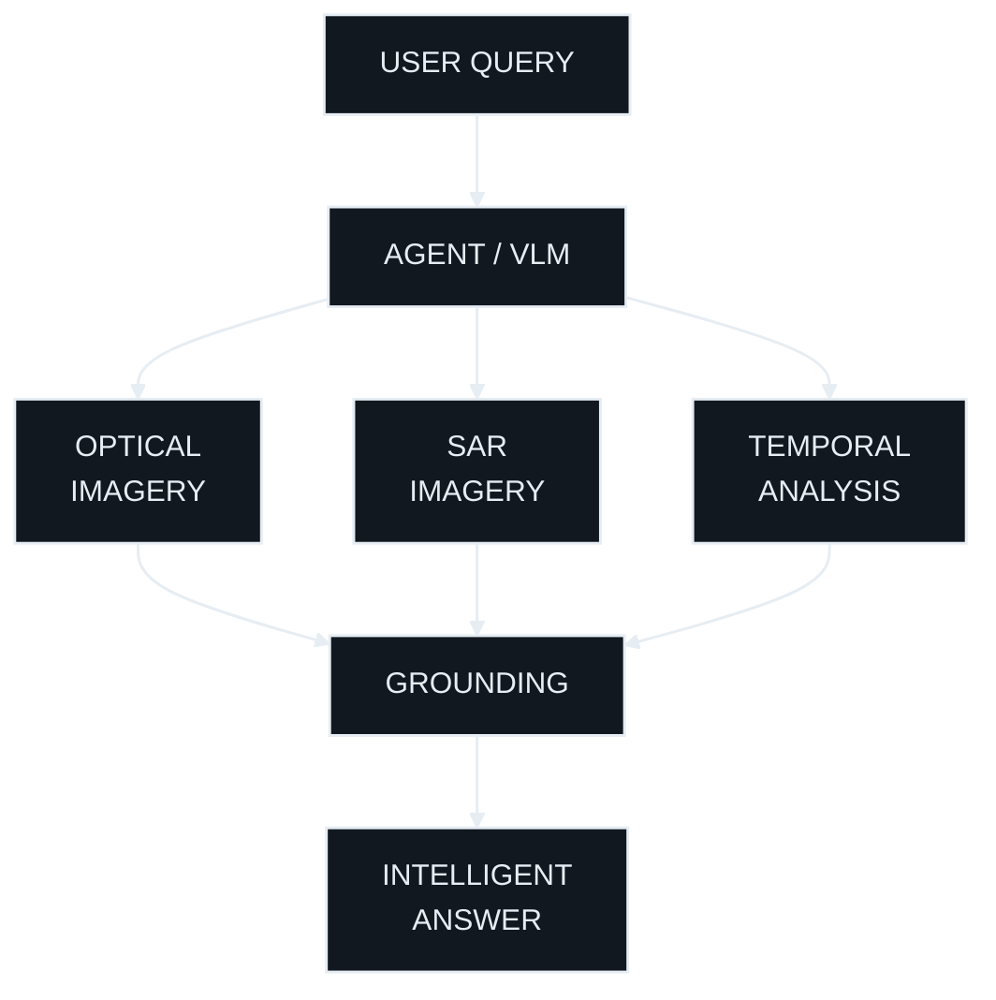

<div align="center">

# APOORV JHA

### AI & Data Science • Builder • Problem Solver

<br>


<br><br>

<a href="https://github.com/Apoorvishere?tab=followers">

</a>

</div>

---

## Who Am I?

```text

┌──────────────────────────────────────────────────────────────┐
│                          APOORV JHA                          │
├──────────────────────────────────────────────────────────────┤
│                                                              │
│  [EDU]  B.Tech — Artificial Intelligence & Data Science      │
│                                                              │
│  [AI]   AI, Computer Vision & Intelligent Systems            │
│                                                              │
│  [DEV]  Building SatQuery AI                                 │
│                                                              │
│  [HACK] Hackathon Enthusiast                                 │
│                                                              │
│  [LAB]  Learning by Building                                 │
│                                                              │
│  [COF]  Powered by Questionable Amounts of Caffeine          │
│                                                              │
└──────────────────────────────────────────────────────────────┘

```

I'm an **AI & Data Science student** who likes taking ideas that sound slightly ridiculous and trying to turn them into actual systems.

Currently, most of my time goes into **AI/ML, computer vision, remote sensing, software engineering and figuring out how things work under the hood.**

> **Build → Break → Debug → Learn → Repeat.**

---

## Current Mission

<div align="center">

# 🛰️ SATQUERY AI

<a href="https://github.com/Apoorvishere/SatQuery-AI">

</a>

<br><br>

**An Agentic Vision-Language Assistant for Multimodal Remote Sensing Image Analysis**

</div>

<br>



### What It Can Do

| Capability | Description |
|---|---|
| 👁️ **Vision-Language** | Understand natural-language questions about satellite imagery |
| 🛰️ **Optical + SAR** | Combine complementary remote-sensing modalities |
| ⏳ **Temporal Analysis** | Reason about changes across different points in time |
| 🎯 **Grounding** | Connect answers to relevant regions and features |
| 🤖 **Agentic Tools** | Dynamically select tools required to answer a query |
| 🔍 **Remote Sensing** | Analyze complex geospatial imagery and phenomena |

<div align="center">

<a href="https://github.com/Apoorvishere/SatQuery-AI">

</a>

</div>

---

## Tech Stack

<div align="center">

### Languages


<br><br>

### AI & Data


<br><br>

### Development


<br><br>

### Currently Learning


</div>

---

## Capabilities

```text
Artificial Intelligence
████████████████████░░  90%

Computer Vision
█████████████████░░░░░  80%

Python
██████████████████░░░░  85%

C / C++
██████████████░░░░░░░░  70%

Machine Learning
███████████████░░░░░░░  75%

DSA
███████████░░░░░░░░░░░  55%

Systems / Backend
███████████░░░░░░░░░░░  55%

Knowing What I'm Doing
███████░░░░░░░░░░░░░░░  35%
```

*Percentages are unofficial. Please don't use them in a performance review.*

---


## Featured Projects

<div align="center">

<a href="https://github.com/Apoorvishere/SatQuery-AI">

</a>

<a href="https://github.com/Apoorvishere/OMNIS">

</a>

<a href="https://github.com/Apoorvishere/RIGOR">

</a>

<a href="https://github.com/Apoorvishere/AccessPath">

</a>

</div>

### 🛰️ SatQuery AI

> Agentic multimodal intelligence for remote-sensing imagery.

**Stack:** `Python` `VLMs` `Computer Vision` `Remote Sensing` `SAR` `Optical Imagery`

---

### 🧠 OMNIS

> An intelligent document exploration workspace combining search, source tracing, and knowledge graph visualization to make complex information easier to navigate.

**Stack:** `Document Intelligence` `Information Retrieval` `Knowledge Graphs` `AI`

---

### 📈 RIGOR

> A research-oriented framework exploring the reliability, reproducibility, and statistical credibility of quantitative trading strategies and AI-driven financial research.

**Stack:** `Python` `Quantitative Finance` `Statistical Analysis` `Backtesting` `Machine Learning`

---

### ♿ AccessPath

> An agentic web accessibility auditing prototype that evaluates websites through real browser interactions, helping uncover accessibility barriers in practical user workflows.

**Stack:** `TinyFish` `Playwright` `axe-core` `Supabase` `Web Accessibility`

---

### 🔭 More Projects Coming

I'm building and experimenting across:

```text
├── Artificial Intelligence
├── Computer Vision
├── Remote Sensing
├── Generative AI
├── Agentic Systems
├── Data Science
├── Backend Systems
└── Whatever Seems Interesting at 2 AM
```

---


## GitHub Statistics

<div align="center">

<a href="https://github.com/Apoorvishere">

</a>

<a href="https://github.com/Apoorvishere">

</a>

</div>

<br>

<div align="center">


</div>

---

## Contribution Matrix

<div align="center">

<a href="https://github.com/Apoorvishere">

</a>

</div>

<br>

<div align="center">

<a href="https://github.com/Apoorvishere">

</a>

&nbsp;&nbsp;

<a href="https://github.com/Apoorvishere">

</a>

</div>

---

## Terminal

```text
┌─────────────────────────────────────────────────────────────┐
│ apoorv@github:~$ ./about_me                                │
├─────────────────────────────────────────────────────────────┤
│                                                             │
│  [✓] AI & Data Science                                     │
│  [✓] Computer Vision                                       │
│  [✓] Remote Sensing                                        │
│  [✓] Python / C / C++                                      │
│  [✓] Git & GitHub                                           │
│  [✓] Building Things                                       │
│                                                             │
│  [>] Current process: SatQuery AI                          │
│  [>] Current mission: Learn → Build → Ship                 │
│  [>] Current status: ONLINE                                │
│                                                             │
│  apoorv@github:~$                                          │
│  _                                                          │
└─────────────────────────────────────────────────────────────┘
```

---

## Things I Like

```text
🛰️  Satellite imagery
🤖  Artificial intelligence
🧠  Machine learning
👁️  Computer vision
💻  Systems & software
🚀  Hackathons
🎮  Games
🦖  Dinosaurs
🌌  Space
⚔️  Massive fictional universes
☕  Coffee
```

---

## Beyond The Code

I don't just want to learn technologies.

I want to understand **why they work, where they fail, and what can be built with them.**

That's why I'm particularly interested in projects where multiple fields collide:

```text
             AI
             │
             ├──────── Computer Vision
             │                │
             │                ▼
             │         Remote Sensing
             │                │
             ▼                ▼
          Agents ───────► SATQUERY
             │
             ▼
       Real-World Systems
```

---

## Achievements

```text
🏆  Building SatQuery AI
🤖  Working on Agentic AI Systems
🛰️  Exploring Multimodal Remote Sensing
💻  Building Open-Source Projects
🚀  Participating in Hackathons & Developer Events
📚  Constantly Learning Something New
```

---

## Connect With Me

<div align="center">

<a href="https://github.com/Apoorvishere"></a>
&nbsp;&nbsp;
<a href="https://www.linkedin.com/in/apoorv-jha-125557414/"></a>
&nbsp;&nbsp;
<a href="mailto:apoorvjha587@gmail.com"></a>

</div>

---

<div align="center">

### If You're Building Something Interesting, Let's Talk.

`AI` · `Computer Vision` · `Remote Sensing` · `Open Source` · `Hackathons`

<br>

**`< / keep building >`**

</div>
